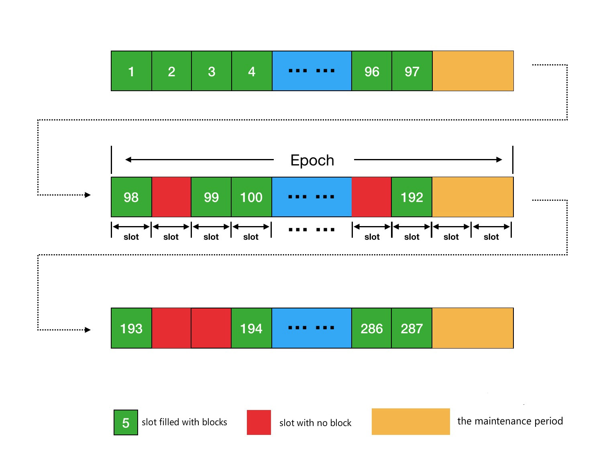
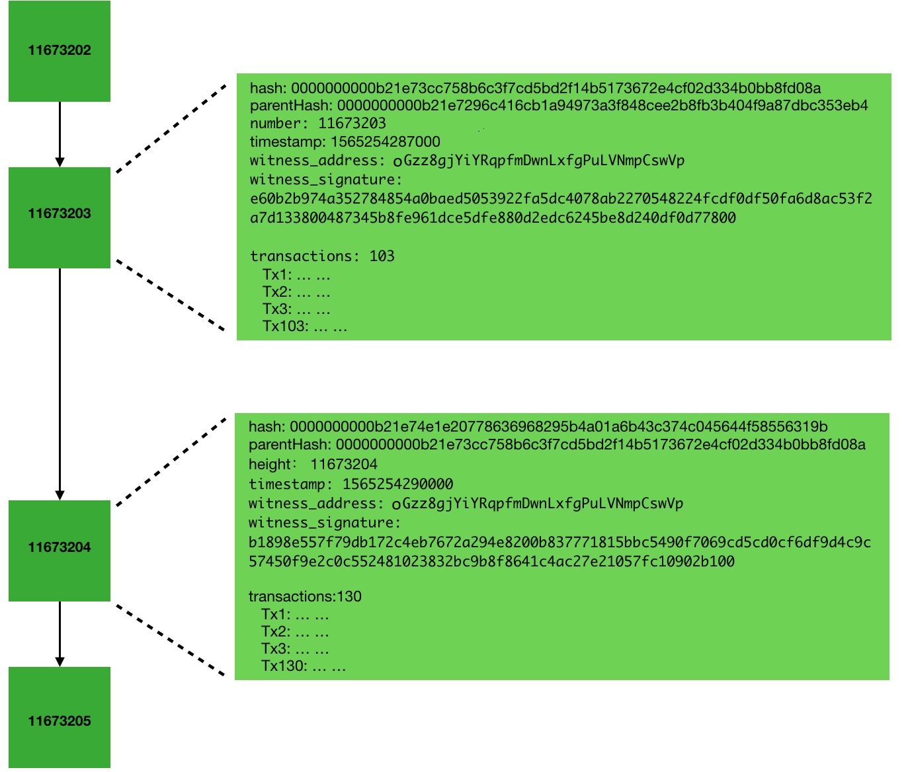
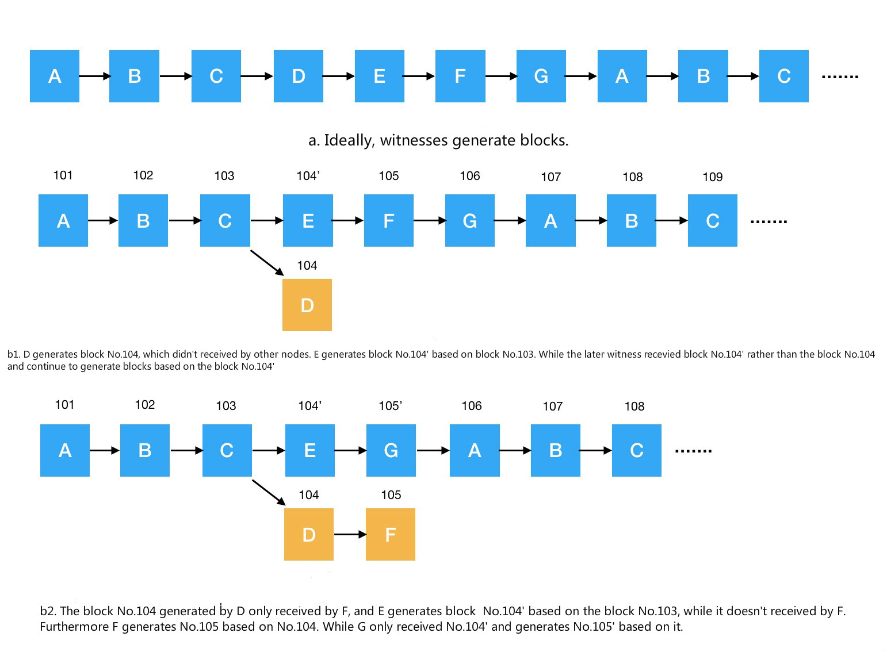
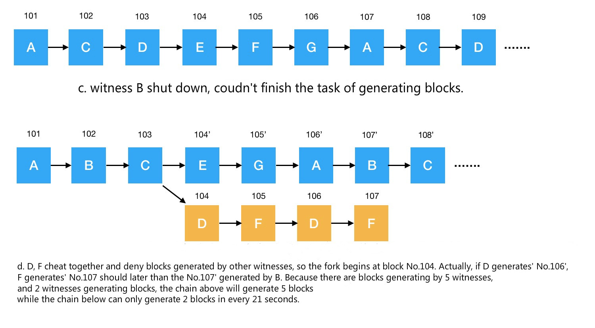

# TRON DPoS Consensus Mechanism

## Overview

As a distributed ledger system, a blockchain can be maintained by many independent nodes across different regions, each keeping a copy of the ledger and synchronizing data over the network. To record new transaction data in this shared ledger, nodes need to validate transactions according to the consensus rules and agree on which blocks to accept. Achieving this in a distributed environment where some participants may fail or act maliciously is a complex engineering challenge.

A **consensus mechanism** defines the rules for reaching this agreement. Different consensus mechanisms have different requirements for participation and agreement.

Currently, mainstream consensus mechanisms include Proof of Work (PoW), Proof of Stake (PoS), and Delegated Proof of Stake (DPoS), and each mechanism has its unique specific implementation in different blockchain systems. This document will focus on the DPoS consensus mechanism adopted by the **TRON network** and elaborate on its core components and operational principles.

### DPoS Consensus Mechanism

The core role of the DPoS consensus mechanism in a blockchain system is to elect **Super Representatives (SRs)**, which are the designated Block Producers for the network. These SRs are responsible for validating transaction data and recording it onto the ledger, subsequently broadcasting the new block containing the new entries to the entire network, and gaining recognition from other nodes.

In DPoS consensus, the system selects a subset of nodes as SRs based on the number of votes they receive. The election process is as follows:

1. **Initial Setup:** When the blockchain system launches, a certain amount of **tokens** (e.g., TRON's TRX) are issued.
2. **Becoming a Candidate:** Nodes can spend a portion of these tokens to apply to become an SR **candidate**.
3. **Community Voting:** Any node in the network holding tokens can vote for these candidates.
4. **Vote Tallying and Election:** After a preset **time period** (e.g., `t`), the system tallies the votes for all candidates, and the top `N` candidates by vote count become the SRs for the next time period.
5. **Cycle Rotation:** After the time period ends, the system re-tallies votes and elects new SRs, and so on.

The following will provide a detailed explanation, integrating the specific implementation within the TRON network.

## Core Concept Definitions

| Concept | Definition |
| -------- | -------- |
| TRON     | The TRON blockchain network. This document does not distinguish between TRON, TRON blockchain, TRON blockchain system, etc.|
|TRX| The equity token issued and circulated within the TRON blockchain system, with the ticker symbol **TRX**.|
|Super Representative (SR) |A node in the TRON network that has obtained block production qualifications. TRON sets the number of SRs at **27**. This document does not distinguish between block producer, Witness, SuperNode, SR, etc.|
|Super Representative Candidate| A node in the TRON network that is eligible to become an SR.|
|Super Representative Partner (SRP)| SR candidates ranked from **28th** to **127th** by vote count. They do not participate in block production or transaction packaging but can receive voting rewards. Their voters can share the rewards remaining after the SRP's commission is deducted.|
|Block Production / Producing Blocks|The process of validating transactions and recording them as entries. Since entries in TRON are carried by blocks, the block production process is also referred to as "producing blocks." This document does not distinguish between block production and producing blocks.|
|Block Production Order (Block Generation Order)|The 27 SRs are ranked from highest to lowest by vote count, which determines their block production order. When two SRs have the same vote count, their addresses are used as a tiebreaker to produce a deterministic order.|
|Slot|In the TRON network, every **3 seconds** is counted as a slot. Under normal circumstances, each SR producing a block will complete block generation within its corresponding slot time. Therefore, TRON's average block generation interval is approximately 3 seconds. If an SR fails to produce a block for any reason, the corresponding slot remains empty, and the next scheduled SR will produce a block in the subsequent slot. During maintenance periods, block production skips 2 slots.|
|Epoch|An epoch is the interval between scheduled maintenance boundaries, currently **6 hours** on mainnet. This interval can be adjusted through an **on-chain proposal**.|
|Maintenance Period|Maintenance is triggered when a node processes the first block whose timestamp reaches or exceeds the scheduled maintenance time. It tallies votes, re-elects the 27 SRs, and updates their block production order. After the maintenance-triggering block, block production **skips 2 slots** (**6 seconds**). With the current 6-hour mainnet interval and normal block production, maintenance occurs **4 times per day**.|

## Block Production Process

SRs in the TRON blockchain system continuously execute the following process:

1. **Collect Transactions:** SRs collect newly generated transactions from the blockchain network.
2. **Validate Transactions:** The legitimacy of these transactions is verified.
3. **Package Blocks:** Validated transactions are packaged into a **block** in order to record them as a new page of entries to the ledger.
4. **Broadcast Blocks:** The newly generated block is broadcast throughout the entire blockchain network.
5. **Other Node Verification:** Upon receiving the new block, other nodes also verify the legitimacy of the transaction data within it and add it to their own ledgers.

SRs continuously repeat this process to ensure that all new transaction data in the TRON system is promptly recorded onto the ledger.

## Super Representative Election Mechanism

### Votes

Before voting for SRs, an account needs to acquire **voting power**, specifically **TRON Power (TP)**. Voting power is obtained by **staking TRX**. Staking TRX grants users voting power (TRON Power) in addition to Bandwidth or Energy. For every **1 TRX** staked, a user receives **1 TP**.

Unstaking TRX staked under **Stake 1.0** clears all of the account's existing votes.

Under **Stake 2.0**, unstaking TRX reduces the account's TP. Existing votes remain unchanged if the remaining TP covers the account's total votes. Otherwise, the remaining TP is allocated according to each candidate's share of the account's previous total votes, and each resulting vote count is rounded down to an integer. The total retained votes may therefore be less than the remaining TP.

Votes are tallied and SRs and SRPs are updated during each maintenance period, currently scheduled every **6 hours** on mainnet. If an account casts multiple votes before the vote tally, the TRON network will only record the account's **latest vote**, and previous votes will be overwritten.

### Voting Process

In TRON, voting for candidates is defined as a special type of **transaction**. Nodes can vote for candidates by generating a voting transaction.

### Tallying Votes

During each **maintenance period**, the system tallies the votes for all candidates and selects the **27** candidates with the most votes to be the SRs for the next block production cycle.

## Block Production Mechanism

In an **epoch**, the 27 SRs will produce blocks sequentially according to their **block production order**. Each SR can produce a block only during its designated turn.

SRs package multiple valid transaction data into each block. At the same time, each block fills in the **hash value** (`hash`) of the previous block as its **parent hash value** (`parentHash`). Furthermore, the SR uses their private key to sign the current block's data, and the **signature result** (`witness_signature`), along with the SR's address, block height, block generation time, and other data, are also filled into the block.

In this way, each block stores the hash value of the previous block, thereby logically linking the blocks together and ultimately forming the blockchain's chain structure. A typical blockchain structure diagram is as follows:

Ideally, in a blockchain system adopting DPoS consensus, the block production process should strictly follow a pre-calculated block production order, with SRs taking turns to produce blocks sequentially (as shown in Figure a below). However, a real blockchain network is a distributed, untrustworthy, and complex system, and the following situations may occur:

1. **Network Latency:** Due to poor network link conditions, a block produced by an SR might not be received by other SRs within the effective time (as shown in Figures b1, b2 below).
2. **Node Failure:** Some SRs may not always operate normally (as shown in Figure c).
3. **Malicious Behavior:** A few SRs might maliciously produce fork blocks, attempting to split the main chain (as shown in Figure d).

Ledger security is fundamental to blockchain security: the ledger must be protected against malicious writes of invalid data, and its copies maintained by different nodes should remain consistent. Under DPoS consensus, SRs are responsible for producing blocks. In TRON's block solidification process, each active SR's confirmation carries equal weight. TRON's security therefore depends on a sufficient number of active SRs honestly and reliably following the consensus rules.

TRON has established an **irreversible block** (or **solidified block**) mechanism, and to resist malicious behavior from a few block-producing nodes, TRON adopts the **longest chain principle** to confirm the main chain.

### Solidified Block Principle

Newly produced blocks initially remain in an unconfirmed state. The process of solidification works as follows:

* A block becomes an **irreversible block** (commonly referred to as a **solidified block**) when at least **70%** of the **currently active SRs** have a latest produced block height greater than or equal to its height on the current chain. With 27 active SRs, this requires **19 distinct SRs**. Once solidified, the transactions within it are permanently confirmed by the entire network.
* An SR acknowledges a block by producing the block itself or a subsequent block that builds upon it. Only SRs in the current active set count toward the threshold, so changes to that set during maintenance can change which producers count. The solidified height never decreases when the active set changes.
* With an unchanged set of 27 active SRs, the original block producer plus **18 other distinct SRs** producing subsequent blocks that build upon the target block are sufficient to solidify it. Repeated blocks from the same SR do not add distinct confirmations.

Figure d illustrates a simplified network with a fixed set of **seven SRs (A–G)**. In this example, the 70% threshold requires **five distinct SRs**. SR C produces block 103, SR E produces block 104' based on block 103, and SRs G, A, and B produce blocks 105', 106', and 107' respectively on the same branch. These are all subsequent blocks to block 103, signifying their producers' acknowledgment of the block produced by C. Thus, when block **107'** is produced, block **103 becomes solidified** because it has accumulated four subsequent blocks produced by four different SRs. Including C, the original block producer, this gives **five distinct SR confirmations**.

### Longest Chain Principle

When a blockchain forks, honest SRs will always choose to continue producing blocks on the currently **longest** fork chain. Receiving an alternative branch of the same height does not by itself trigger a switch.

## Incentive Model

To ensure the secure and efficient operation of the TRON blockchain system, TRON has designed an incentive model to encourage more nodes to join the TRON network, thereby expanding network scale.

The reward amounts below reflect the **current mainnet values** after adjustment through on-chain proposals; they are not protocol-hardcoded and can be changed again via future proposals (see [Proposal-Based Parameter Adjustment](#proposal-based-parameter-adjustment)).

* **Block Production Rewards:** For every block successfully produced in the TRON network, the corresponding SR is rewarded with **8 TRX**. After deducting a self-defined commission rate, the SR distributes the remaining block rewards to their voters proportionally based on voting weight.
* **Voting Rewards:** With the generation of each block, the TRON network also awards an additional **128 TRX** to all SRs and SRPs. This reward is distributed based on their respective vote proportions. Similarly, after deducting their commission based on their set commission rate, SRs and SRPs distribute the remaining voting rewards to their respective voters based on the voters' voting weight.

## Proposal-Based Parameter Adjustment

Dynamic chain parameters supported by the TRON node software can be adjusted through **on-chain proposals**. SRs decide whether a proposal takes effect by voting on it.

For TRON's current network parameters and their values, as well as past proposal records, please refer to the [TRONSCAN Committee](https://tronscan.org/#/sr/committee) Page.

## References

* [The Basics of TRON’s DPoS Consensus Algorithm](https://medium.com/tronnetwork/the-basics-of-trons-dpos-consensus-algorithm-db12c52f1e03)
